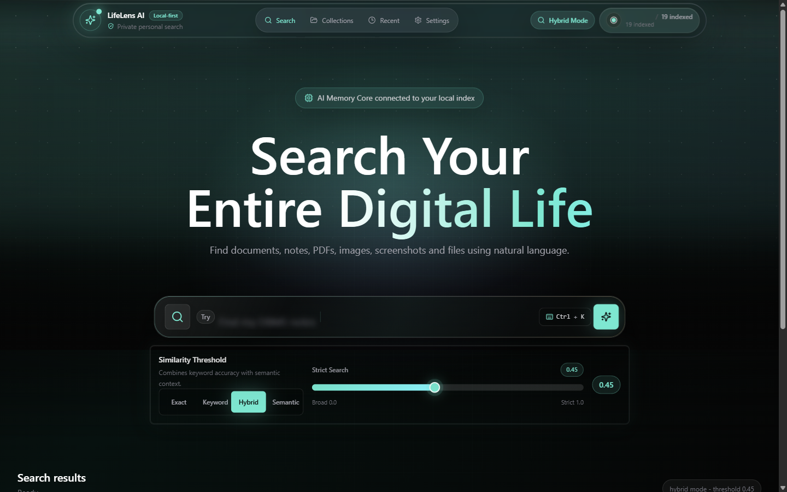
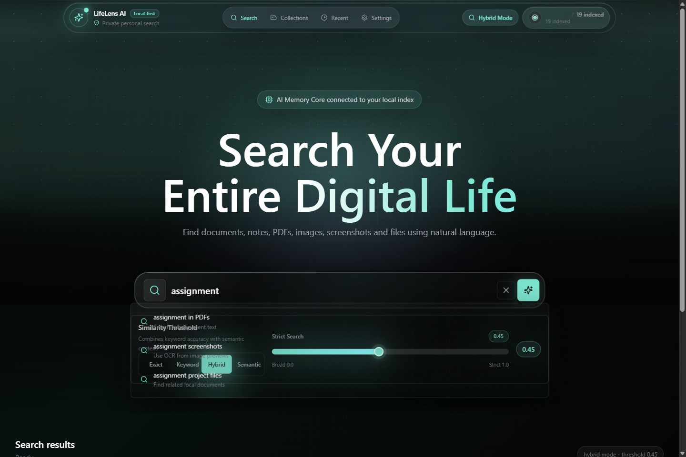

# LifeLens AI

LifeLens AI is a local-first, AI-powered personal search engine for finding documents, notes, PDFs, images, screenshots, and files with natural language. It combines keyword-first ranking, OCR, text extraction, CLIP image embeddings, Sentence-BERT text embeddings, and FAISS vector search behind a premium React interface.

## 📸 Screenshots

<div align="center">
  
  <p><em>LifeLens AI — Intelligent Local Search & 3D Memory Core</em></p>
  <br />
  
  <p><em>Multimodal Hybrid Search with Instant Document Preview and Relevance Explanations</em></p>
</div>

## Overview

Modern personal files are scattered across folders, formats, screenshots, PDFs, notes, and project archives. LifeLens AI indexes that digital workspace locally and lets users search it with queries such as:

- `Find my DBMS notes`
- `Goa trip photos`
- `DAX formulas`
- `AI project files`

The project is privacy-focused by design. Files are indexed locally, embeddings are stored locally, and search runs against a local FastAPI backend.

## Features

- Natural language search across files, documents, notes, PDFs, images, and screenshots.
- CLIP-based image embeddings for visual search.
- Sentence-BERT text embeddings for semantic text search.
- FAISS-backed vector storage with persistent metadata.
- Exact, Hybrid, and Semantic search modes.
- Keyword-first ranking to reduce irrelevant semantic matches.
- Similarity threshold filtering for stricter search control.
- OCR support for images and PDFs through Tesseract.
- Full text extraction from PDF, TXT, Markdown, and DOCX files.
- Real-time file monitoring with Watchdog.
- Smart grouping for related files and collections.
- Premium React interface with Framer Motion and React Three Fiber.
- Right-side preview panel for images, documents, metadata, scores, and match explanations.

## Architecture

```text
LifeLens AI
|-- FastAPI backend
|   |-- Routes: search, indexing, files, health, clusters
|   |-- Services: embeddings, OCR, indexing, FAISS, ranking, clustering
|   `-- Models: typed request/response schemas
|-- Local vector database
|   |-- database/faiss/text/
|   `-- database/faiss/images/
|-- File indexing script
|   `-- index_files.py
`-- React frontend
    |-- Search experience
    |-- Result cards
    |-- Preview panel
    `-- AI Memory Core 3D scene
```

See [PROJECT_ARCHITECTURE.md](PROJECT_ARCHITECTURE.md) for a deeper technical breakdown.

## Tech Stack

**Backend**

- Python
- FastAPI
- Pydantic Settings
- FAISS
- Sentence Transformers
- OpenCLIP
- PyTorch
- Pillow
- PyPDF
- PyMuPDF
- pytesseract
- Watchdog

**Frontend**

- React
- Vite
- TypeScript
- Tailwind CSS
- Framer Motion
- Lucide React
- Three.js
- React Three Fiber
- Zustand

## Installation Guide

### 1. Clone the repository

```bash
git clone https://github.com/VaasuDhawale/LifeLens.git
cd LifeLens
```

### 2. Create a backend environment

```bash
python -m venv .venv
```

Activate it:

```bash
# Windows PowerShell
.\.venv\Scripts\Activate.ps1

# macOS / Linux
source .venv/bin/activate
```

Install Python dependencies:

```bash
pip install -r requirements.txt
```

### 3. Configure environment variables

Copy the example environment file:

```bash
cp .env.example .env
```

On Windows PowerShell:

```powershell
Copy-Item .env.example .env
```

Update values only when needed. If Tesseract is not available on `PATH`, set `TESSERACT_CMD` to the absolute path of the executable.

### 4. Install frontend dependencies

```bash
cd frontend
npm install
```

## Usage Instructions

### Start the backend

From the repository root:

```bash
uvicorn app.main:app --reload
```

The backend runs at:

```text
http://127.0.0.1:8000
```

Health check:

```text
GET http://127.0.0.1:8000/api/v1/health
```

### Index sample files

From the repository root:

```bash
python index_files.py
```

By default, this indexes `test_data/`. To index another folder:

```bash
python index_files.py "path/to/folder"
```

Generated FAISS indexes and metadata are written under `database/faiss/`. These files are ignored by Git because they are local runtime artifacts.

### Start the frontend

```bash
cd frontend
npm run dev
```

The frontend runs at:

```text
http://127.0.0.1:5173
```

### Search API

```text
POST http://127.0.0.1:8000/api/v1/search
```

Example payload:

```json
{
  "query": "final year project",
  "threshold": 0.45,
  "mode": "hybrid",
  "limit": 24
}
```

Search modes:

- `exact`: keyword matching only; ignores semantic threshold.
- `hybrid`: keyword-first ranking with semantic similarity as a support signal.
- `semantic`: broader embedding-based discovery.

## Screenshots

Add screenshots before publishing a release:

```text
docs/screenshots/hero-search.png
docs/screenshots/results-grid.png
docs/screenshots/preview-panel.png
```

Suggested screenshots:

- AI Memory Core search interface.
- Search results with highlighted matches.
- Right-side file preview panel.
- Exact, Hybrid, and Semantic mode controls.

## Future Improvements

- Add authentication for multi-user deployments.
- Add optional encrypted local metadata storage.
- Add cross-device sync with user-controlled storage.
- Add background indexing queue persistence.
- Add video frame extraction and video transcript search.
- Add native file-open integration per operating system.
- Add automated frontend and backend test suites.
- Add packaged desktop builds.

## License

This project is released under the MIT License. See [LICENSE](LICENSE) for details.
